<p align="center">
  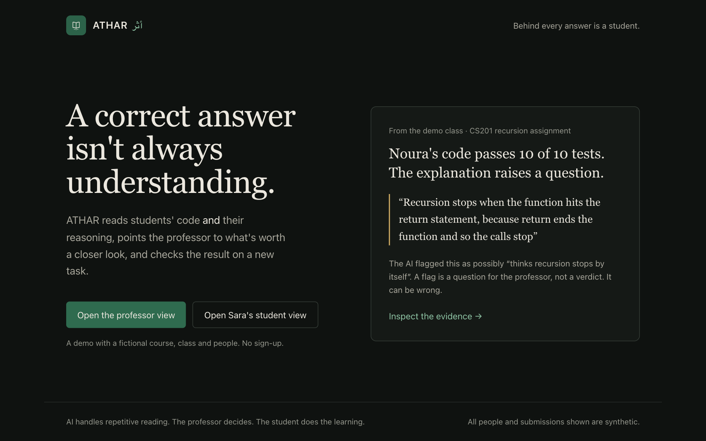
</p>

# ATHAR | أثر

### A correct answer isn't always understanding.

ATHAR helps a university professor look past whether code passed, to whether students understand why it works. It reads students' written reasoning beside their code, points the professor to the evidence worth a closer look, prepares targeted support that the professor approves, and checks the result on a new task the student does alone.

**AI handles the repetitive reading. The professor makes the educational judgments. The student does the learning.**

> **What this is:** a working hackathon prototype built for the HUMAIN Future AI Builders Hackathon. Every course, student and submission is **synthetic** and labelled as such. No real professor or student has used it yet.

<p align="center"><b>Assess</b> &nbsp;→&nbsp; <b>Understand</b> &nbsp;→&nbsp; <b>Intervene</b> &nbsp;→&nbsp; <b>Verify</b></p>

| | |
|---|---|
| **See it** | Demo video: *link added at submission* · Slides: *link added at submission* · [Product walkthrough](docs/WALKTHROUGH.md) |
| **Trust it** | [Evaluation results](docs/EVALUATION.md) · [Engineering and evidence audit](docs/AUDIT.md) · [Evidence for each judging criterion](docs/JUDGING.md) |
| **Run it** | [Run ATHAR locally](#run-atharlocally) · about 10 minutes, no API key needed for the stored demo |

---

## Contents

1. [The problem](#1-the-problem)
2. [Where the idea came from](#2-where-the-idea-came-from)
3. [What ATHAR does](#3-what-athar-does)
4. [One student, start to finish](#4-one-student-start-to-finish)
5. [The professor and student experience](#5-the-professor-and-student-experience)
6. [What makes it agentic, and where it stops](#6-what-makes-it-agentic-and-where-it-stops)
7. [Architecture](#7-architecture)
8. [Measured results](#8-measured-results)
9. [What failed, and what it changed](#9-what-failed-and-what-it-changed)
10. [Privacy and responsible deployment](#10-privacy-and-responsible-deployment)
11. [Run ATHAR locally](#run-atharlocally)
12. [Reproduce the results](#12-reproduce-the-results)
13. [Limitations and next steps](#13-limitations-and-next-steps)
14. [Credits and licence](#14-credits-and-licence)

---

## 1. The problem

A professor teaches CS201 to 120 students. Assignment 3 asks for two recursive functions, `power` and `sum_list`, plus a short written explanation of why each one stops.

The autograder runs, and most submissions pass. But a passing test only shows that the code produced the right output. It doesn't show whether the student knows *why* it works. Reading 114 explanations with real attention, every week, isn't something one person can do.

Here is one student from the (synthetic) demo class. **Noura's code passes all 10 tests.** Her explanation begins:

> *"Recursion stops when the function hits the return statement, because return ends the function and so the calls stop."*

That's a common misconception. Recursion stops because an explicit condition becomes true at the smallest input, not because a `return` exists. Her grade would say she's done. Her reasoning says she might write a function that never stops next week. Tests can't see this. A professor can, if someone points them to it.

<p align="center">
  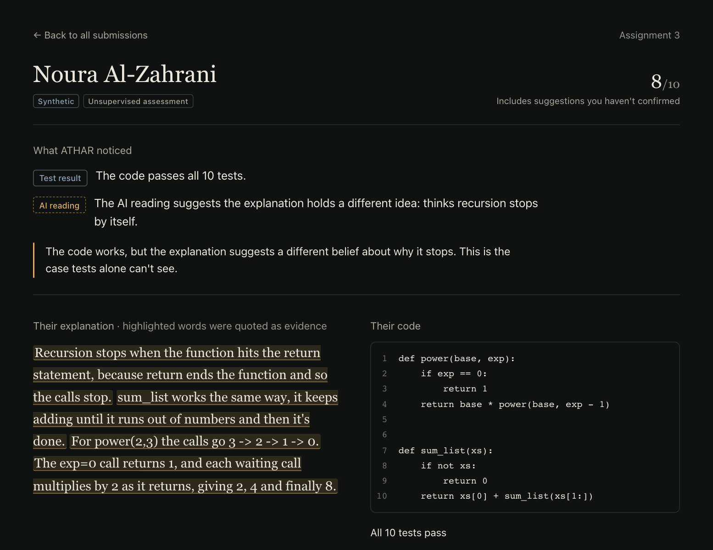
  <br><sub>The professor sees the test result, the AI's reading and the student's own words together. The AI's reading is a suggestion with quotes, not a verdict.</sub>
</p>

## 2. Where the idea came from

The starting point was broader than education. **Standardised systems struggle to respond to the different needs of the individuals they serve.** Could agentic AI help people deliver more individual attention at scale without removing human judgment?

That idea was explored in two separate prototypes: HADIR (personalised hospitality, a different project and repository) and ATHAR (university teaching). Teaching made the problem concrete. One professor, one course, many students, and grades that summarise what happened without explaining it.

Three design principles came from that framing, and each one maps onto code:

| Principle | What it became in the code |
|---|---|
| AI does the repetitive reading | An LLM reads every written explanation and must quote the student word for word (`backend/athar/ai/explanations.py`) |
| The professor makes the judgments | Nothing reaches a student, and no AI suggestion counts towards a grade, until the professor approves (`interventions/service.py`, `grading/evidence.py`) |
| The student does the learning | Help is allowed in practice. Evidence of understanding comes only from a new, unassisted attempt judged by fixed rules (`interventions/verifier.py`) |

## 3. What ATHAR does

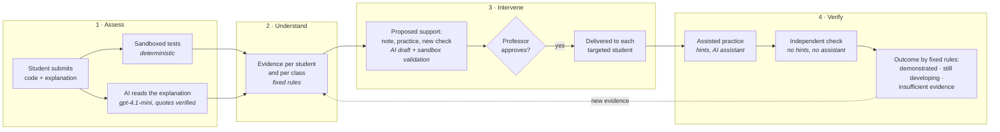

| Step | What happens | Who or what decides |
|---|---|---|
| Submission | Student hands in code and a short explanation | Student |
| Code testing | Each submission runs against visible and hidden tests in an isolated process, with time and memory limits | **Deterministic** sandbox |
| Reading the explanation | The LLM judges the explanation criteria, names possible misconceptions with verbatim quotes, notes contradictions, or abstains | **AI**, then validated: invented quotes are dropped |
| Class insights | Evidence is grouped per misconception, with counts by source, example quotes and test pass rates against the rest of the class | **Deterministic** aggregation |
| Who needs what | Each student lands in exactly one group: base-case gap, code didn't run, working code with flagged reasoning, evidence conflicts, and so on | **Fixed rules** (`planning.py`) |
| Proposed support | A short note (AI-drafted, at most 90 words), a practice problem with hints, and a follow-up check proven in the sandbox to separate correct code from the misconception | **AI drafts**, **deterministic validation** |
| Approval | The professor edits, confirms or rejects. Approval creates one activity per student, exactly once | **Professor** |
| Assisted practice | Real test runs, hints one at a time, an AI assistant. Never counted against the student | Student, with AI help |
| Independent check | A new problem, no built-in hints or assistant, code plus explanation | Student alone |
| Verified outcome | *Demonstrated* only when every test passes **and** the reasoning names the stopping condition | **Fixed rules** (`verify-v1`) over tests and the AI reading |

## 4. One student, start to finish

Noura shows *why* ATHAR reads explanations. **Sara** shows the whole loop. She's the demo's student persona, and her records are consistent from start to finish. Each row says what kind of step it is.

| Step | What the stored record shows | Kind |
|---|---|---|
| **Submitted** | `power` stops at `exp == 1`. Her explanation: *"I don't think power ever needs to handle exp = 0 since there would be nothing to multiply."* | Synthetic data |
| **Tests found** | 8 of 10 pass. `power(2, 0)` and `power(9, 0)` raise `RecursionError`, exactly as the "stops after the smallest input" misconception predicts | Deterministic |
| **Explanation suggested** | The AI flags the same misconception and quotes her sentence about `exp == 1`. Tests and reading agree | Live AI (stored from the class grading run) |
| **ATHAR proposed** | Concept practice for the 14 students in this group: a short note, `product_list` practice with three hints, and a new check, `repeat_text` | Fixed rules + AI-drafted note |
| **Validated** | Sandbox: the correct solution passes 5/5, and code with the misconception is caught on `repeat_text('hi', 0)` | Deterministic |
| **Professor approved** | Layla reads the 68-word note (the checker found no problems) and approves: 14 activities, created once | Professor |
| **Sara did** | *Think first:* "Maybe nothing? An empty list has no numbers to multiply." → practice passes 3/4 (the empty list fails), one hint, then 4/4 → *Look back:* "It should return 1, because multiplying by 1 changes nothing…" | Student actions (scripted for the demo) |
| **New check showed** | `repeat_text` passes 5/5, including `n = 0`, and her explanation names the stopping condition → **demonstrated on this task** | Deterministic tests + live AI reading + fixed rules |
| **What it doesn't prove** | Lasting mastery, or that no outside help was used. The app says both | — |

<table>
<tr>
<td width="50%">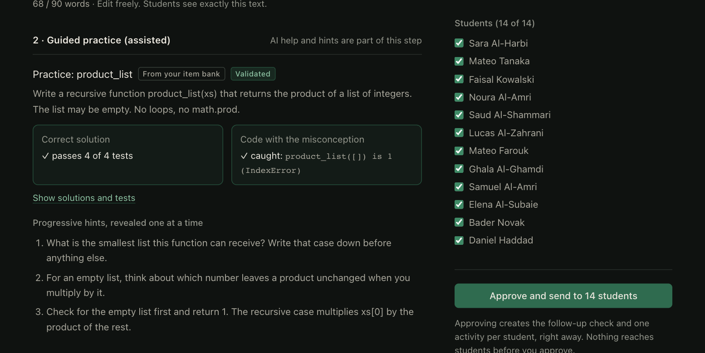</td>
<td width="50%">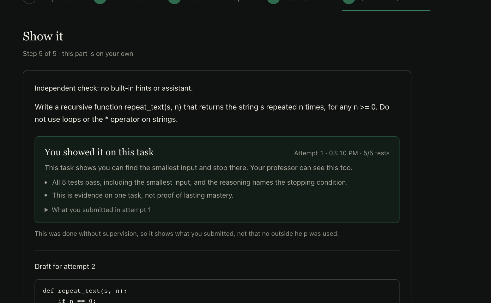</td>
</tr>
<tr>
<td><sub>Before anything reaches a student, the sandbox proves the check can tell understanding from the misconception.</sub></td>
<td><sub>Sara's result on a new problem, done alone, with the caveats on screen.</sub></td>
</tr>
</table>

## 5. The professor and student experience

**Professor (Dr. Layla Al-Mansour, fictional)**

<table>
<tr>
<td width="50%">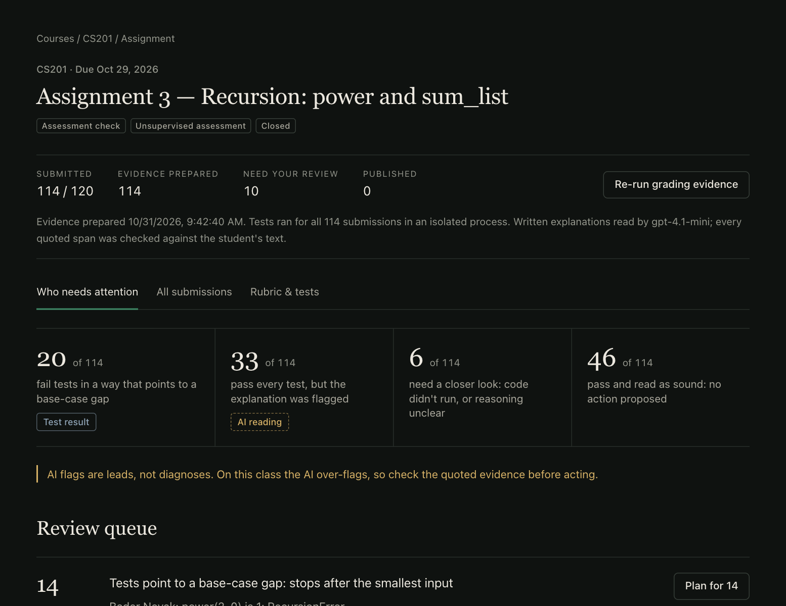</td>
<td width="50%">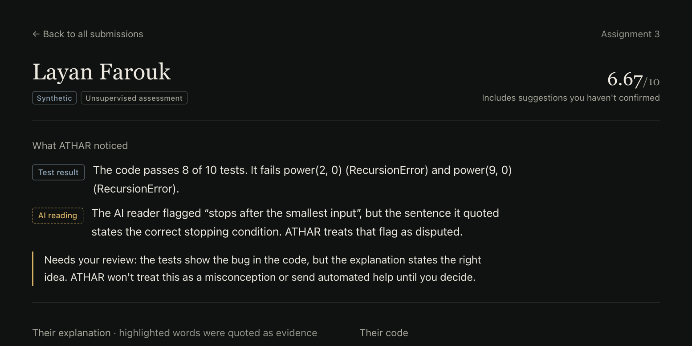</td>
</tr>
<tr>
<td><sub><b>Who needs attention.</b> Every student in exactly one group, with the kind of evidence behind it and a suggested action.</sub></td>
<td><sub><b>When evidence conflicts, ATHAR doesn't guess.</b> Layan's explanation is right and her code is wrong, so she goes to the professor, not into automated help.</sub></td>
</tr>
<tr>
<td>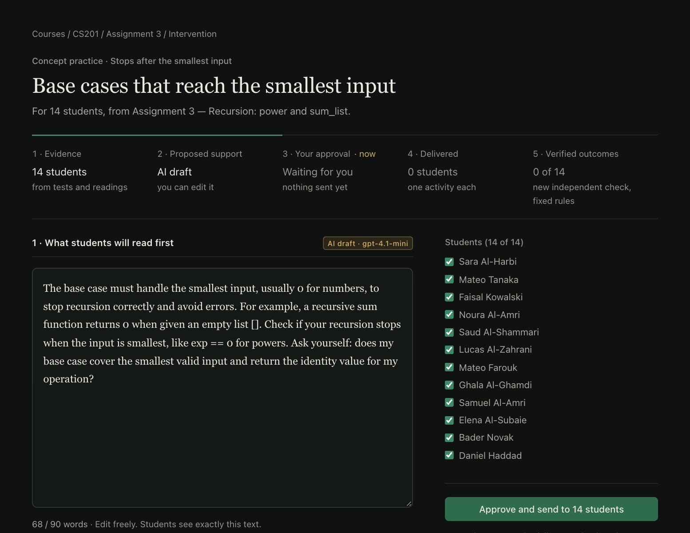</td>
<td>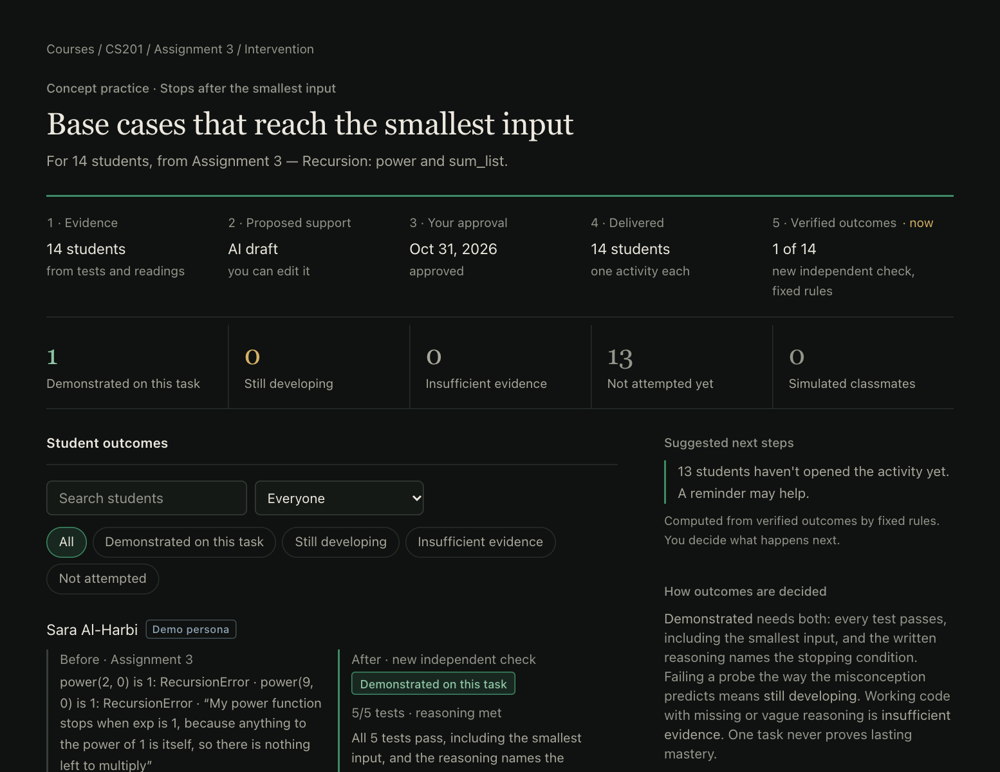</td>
</tr>
<tr>
<td><sub><b>Approval.</b> The AI drafts the note, and the professor edits it. A note over 90 words, or one with a greeting or list, can't be sent.</sub></td>
<td><sub><b>Outcomes.</b> Before and after for each student. Real and simulated students are counted separately.</sub></td>
</tr>
</table>

**Student (Sara Al-Harbi, fictional)**

<table>
<tr>
<td width="50%">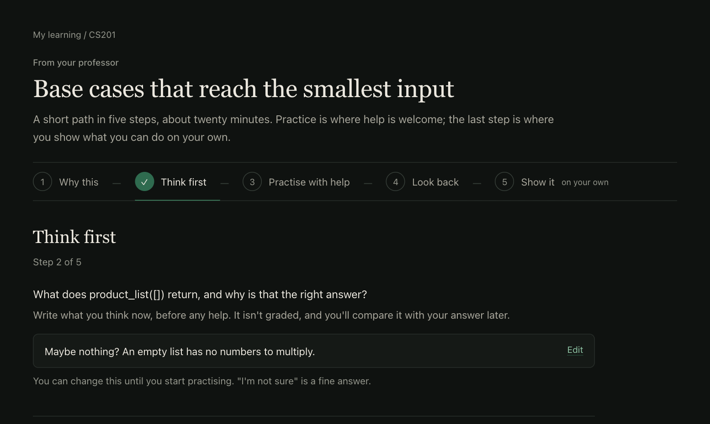</td>
<td width="50%">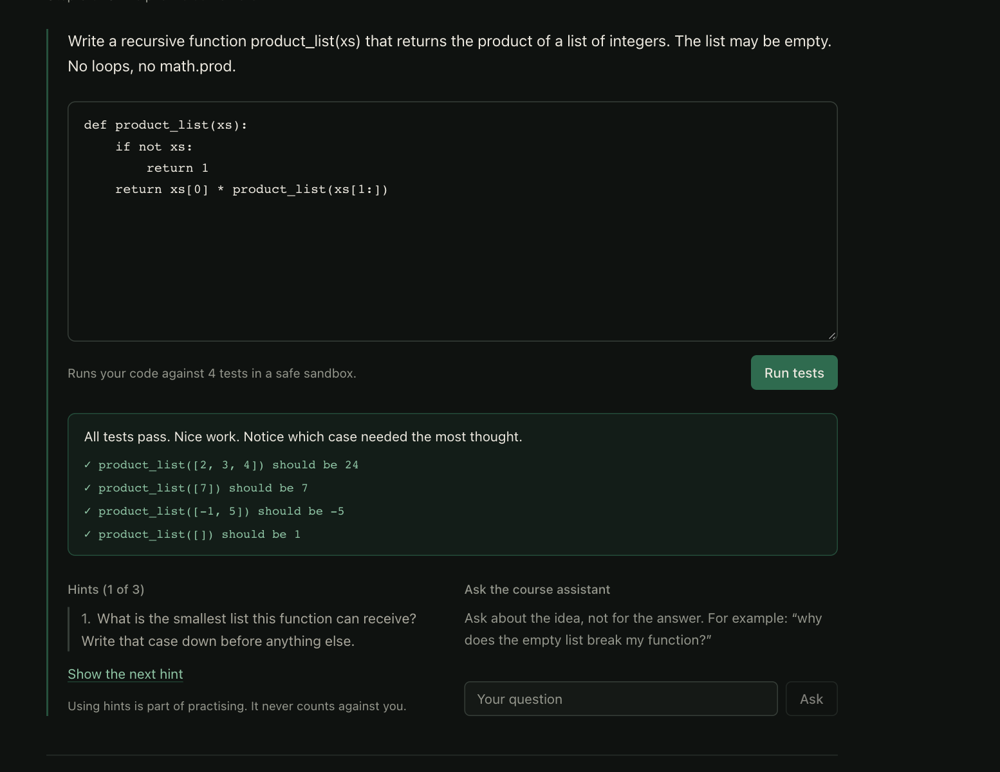</td>
</tr>
<tr>
<td><sub><b>Think first.</b> Her own answer before any help. It locks once practice starts (the server enforces this), so the before-and-after comparison stays honest.</sub></td>
<td><sub><b>Practise with help.</b> Real test runs, one hint at a time, an assistant. Using help is never held against her.</sub></td>
</tr>
<tr>
<td>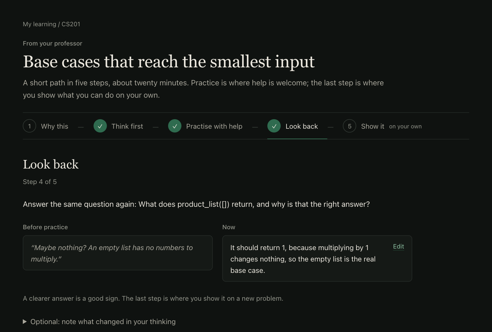</td>
<td>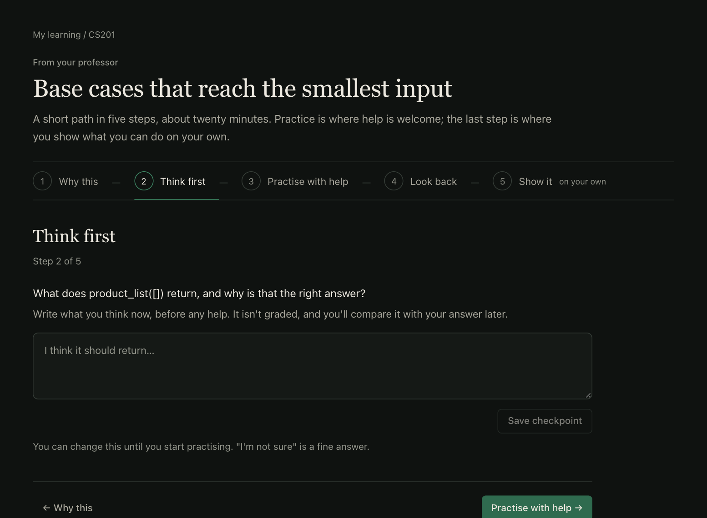</td>
</tr>
<tr>
<td><sub><b>Look back.</b> Before and after, in her own words.</sub></td>
<td><sub><b>Why this.</b> Starts from her own earlier result, not a generic greeting. The note is labelled as AI-drafted and professor-approved.</sub></td>
</tr>
</table>

More screens, including mobile, are in [docs/WALKTHROUGH.md](docs/WALKTHROUGH.md).

## 6. What makes it agentic, and where it stops

ATHAR isn't a chatbot, and it isn't a grading dashboard. It observes evidence, decides what each student needs, prepares and validates the response, executes it once approved, keeps state across the whole process, and evaluates the result. A model contributes where language understanding is required. Fixed rules and a sandbox handle everything that can be checked exactly.

| Capability | How ATHAR does it | AI or rules |
|---|---|---|
| Interpret new evidence | Reads every explanation against the rubric, with stance (a student *rejecting* an idea isn't flagged), contradictions and abstention | **AI**, validated |
| Decide who needs what | Seven groups from tests + reading, including *evidence conflicts → professor first* | **Rules** |
| Prepare personal content | Drafts a short note grounded in the course notes. Builds each student's *Why this* from their own earlier result | **AI** (note), **rules** (personal opener) |
| Select activities | Chooses practice and a check from a validated item bank, or proposes a new check that's usable only if the sandbox validates it | **Rules** + optional **AI** proposal |
| Coordinate approved actions | State machine: draft → approved → active → completed. Execution is idempotent, so repeat clicks never duplicate tasks | **Rules** |
| Deliver and track | One activity per student, with step-by-step progress, practice runs, hints, checkpoints and attempts | **Rules** |
| Verify and recommend | Outcome per student from a new attempt, plus next-step suggestions computed from outcomes | **Rules** over tests + AI reading |

**The approval boundary.** The agent can draft, validate and propose on its own. It can't send anything to a student, publish a grade or count an AI suggestion until the professor acts. That's deliberate: these decisions change what a student is asked to do and how their work is judged.

## 7. Architecture

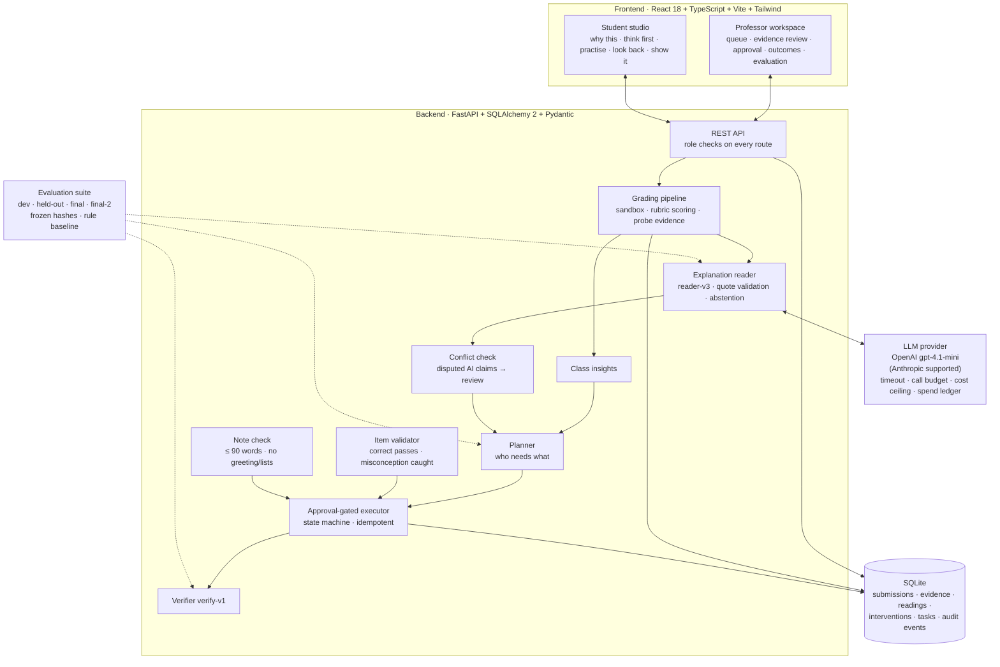

**Model configuration.** `gpt-4.1-mini` through `chat.completions.parse` (structured output into Pydantic schemas). Reader prompt `reader-v3`. A 45 s timeout, a per-process call budget, a per-process cost ceiling (`ATHAR_LLM_MAX_COST_USD`) and an append-only spend ledger. An Anthropic provider is implemented behind the same two-method interface. Without a key, a rule-based reader (`rules-v1`) is used and labelled *Rule-based reading (not AI)* everywhere it appears.

**Why the system is split this way**

- **Language model only for written reasoning.** Students explain recursion in endlessly varied ways. On the untouched final set, keyword rules found 1 of 14 misconceptions.
- **Deterministic code execution.** Whether `power(2, 0)` raises `RecursionError` is a fact. A sandbox establishes it exactly and repeatably. A model would add only uncertainty and cost.
- **Schema validation and verbatim quotes.** Every AI claim about a student must quote the student. Quotes that don't appear in the text are dropped, and the run records it.
- **Traceability.** Every count links back to submissions. Every AI output is stored as returned, including the ones ATHAR later disputes.
- **Professor approval for consequential actions.** The AI drafts and proposes, the professor decides, deterministic code executes.
- **Independent verification after practice.** Help during practice is good teaching, but it isn't evidence. Outcomes come only from a new attempt without built-in help.

More detail: [docs/ARCHITECTURE.md](docs/ARCHITECTURE.md).

## 8. Measured results

All numbers below are read from committed result files in [`backend/evals/results/`](backend/evals/results/). The charts are generated from those files by [`docs/assets/make_charts.py`](docs/assets/make_charts.py).

### The evaluation sets

| Set | Size | How it was made | Status |
|---|---|---|---|
| **dev** | 114 explanations, 113 programs | Generated from the synthetic class templates | Used to build things. Rules were written from it, so rule numbers here are optimistic |
| **held-out** | 32 explanations, 20 programs, 12 verifier cases | Hand-written after rules-v1 and the verifier were frozen | Unseen for rules and verifier. **Its failures informed the LLM prompt**, so LLM numbers on it are development numbers |
| **final** | 36 explanations · 12 verifier · 12 diagnosis · 6 item variants | Hand-written after reader-v2, rules-v1, the verifier and planning rules were frozen; committed before any run | **Untouched.** The reported generalisation result |
| **final-2** | 24 code + explanation pairs | Written after reader-v2 results were seen, before reader-v3 existed; committed before any run | **Untouched** for every reader version reported |

Labels were written by one person, the project author, against a fixed rubric. Dataset and prompt hashes were recorded before the live runs ([`FREEZE.json`](backend/evals/FREEZE.json)). Model: `gpt-4.1-mini`, provider-default sampling.

### A. AI vs keyword rules on the same set

<picture>
  <source media="(prefers-color-scheme: dark)" srcset="docs/assets/charts/ai-vs-rules-final-dark.svg">
  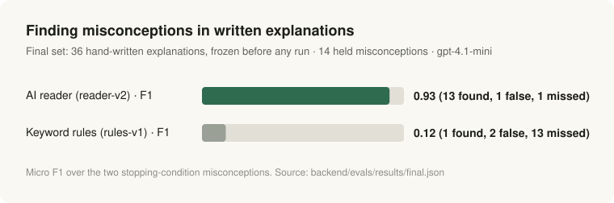
</picture>

On 36 explanations nobody tuned on, the AI reader found 13 of 14 misconceptions with one false alarm. Keyword rules found one. This run used **reader-v2**, the version frozen at the time. The current default, reader-v3, was chosen on development data and measured on final-2 below.

<picture>
  <source media="(prefers-color-scheme: dark)" srcset="docs/assets/charts/ai-vs-rules-final2-dark.svg">
  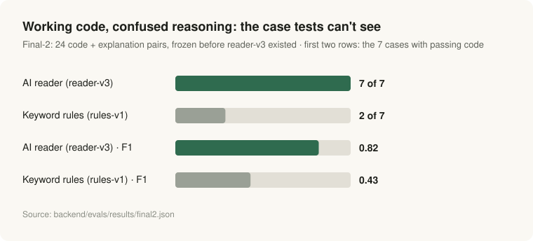
</picture>

Final-2 pairs code with explanations, which is the case tests can't see. Reader-v3 recognised all 7 students whose code works but whose reasoning is confused. Rules recognised 2. Reader-v3's recall is 9/9, but precision is 9/13: it over-flags.

### B. Different needs, different help

<picture>
  <source media="(prefers-color-scheme: dark)" srcset="docs/assets/charts/class-routing-dark.svg">
  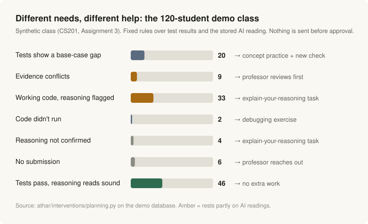
</picture>

The same assignment produces different needs. Students whose code didn't run get debugging, not a recursion lesson. Students who showed understanding get nothing extra. Cases where the evidence disagrees go to the professor first. These are counts on the synthetic demo class, not a measured accuracy. Measured routing accuracy is in the table below.

### C. Where the AI over-flags

<picture>
  <source media="(prefers-color-scheme: dark)" srcset="docs/assets/charts/overflagging-dark.svg">
  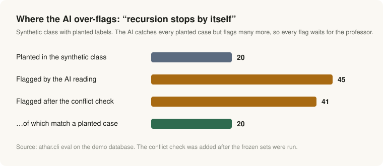
</picture>

On the synthetic class, the AI catches every planted *"recursion stops by itself"* case but flags more than twice as many students. That's why every AI flag is presented as a question for the professor, never as a diagnosis.

### Everything else we measured (final set unless stated)

| What | Result | Note |
|---|---|---|
| Stopping-condition judgment (C3) | AI **20/36** · rules 14/36 · "always met" baseline 14/36 | The AI is too cautious: **0 of 10** correct paraphrases were judged fully correct |
| Negation ("it does *not* stop by itself") | No false misconception **4/4** (rules 3/4) | But C3 on those cases was 0/4 |
| Quotes verbatim in the student's text | **101/101** (final) · 92/92 (final-2, v3) | Unverifiable quotes are dropped by validation |
| Abstention on insufficient answers | Abstained on 75% of cases with insufficient evidence; never abstained when the answer was decidable | 4 of 114 abstentions on the demo class |
| Verifier outcome (tests + reading + rules) | **11/12** with the AI reading · 8/12 with rules | The one miss was cautious: *demonstrated* → *insufficient evidence*, never a false *demonstrated* |
| Routing: right kind of help | 9/12 with AI or rules, 7/12 without a reader (final) · 15/24 v3, 14/24 rules (final-2) | The AI's advantage is in *finding* misconceptions more than in routing |
| Item validator | 6/6 (final), 8/8 (held-out), 15/15 (dev) | Deterministic |
| Code grading, held-out programs | Exact misconception set 18/20, base-case criterion 20/20 | Deterministic |
| Live reliability | 752 logged calls, 0 provider failures, about 3–4 s each | Ledger: `backend/evals/results/spend.jsonl` |
| Backend tests | **60 passed** | Sandbox, rules, reader validation with mocked models, API permission gates, workflow, conflict check, note check |

The full report, with per-case failures, is in [docs/EVALUATION.md](docs/EVALUATION.md).

## 9. What failed, and what it changed

| What happened | What we learned | What it changed |
|---|---|---|
| The keyword reader looked strong on dev (F1 0.90) and collapsed on untouched text (0.12) | It had memorised the dev templates' phrasing | An LLM reader for explanations only, and a rule that rules-v1 stays frozen as a baseline |
| On the synthetic class (development data), reader-v2 missed 13 of 20 "stops by itself" explanations when the code passed | Passing tests were softening the reading | reader-v3 raised that recall to 19/20, at the cost of more false flags. **reader-v3.1 tried to win back precision, was worse, and was rejected.** Final-2 then confirmed v3 on untouched data |
| A "blind" ablation (the reader can't see the code) scored better on C3 (14/24 vs 12/24) | The reader anchors on the code: failing code drags down correct reasoning | The conflict check below, and the anchoring documented as a known weakness |
| Layan: correct explanation, wrong code, and the AI flagged her reasoning anyway, quoting a correct sentence | A model's claim can contradict its own evidence | `grading/disputes.py`: a claim whose quote states the correct idea is **disputed** and sent to the professor, with the original output kept. Synthetic class: 9 students moved to review, all without a planted reasoning misconception, and 4 fewer false flags |
| The AI calls many correct explanations "partial" | It's miscalibrated towards caution | No auto-certification. Those students get a short explain-your-reasoning task, and the verifier leans towards *insufficient evidence* |
| The same prompt flagged 39 students on one run and 45 on another | Live readings vary between runs | Stored readings are the record. Counts are presented as flags for review |
| A live note came out at 97 words | The output schema asked for "120–200 words" and contradicted the prompt | Schema fixed. A deterministic note check blocks approval of notes over 90 words without rewriting them |
| The AI-generated check for one group was rejected by the validator | Generated assessments can't be trusted unchecked | Generated checks are usable only after sandbox validation |

The conflict check was added **after** the final sets were run, and it's measured only on the synthetic class. The frozen-set numbers above are for the reader without it.

## 10. Privacy and responsible deployment

- **Today:** explanations are read by `gpt-4.1-mini` through OpenAI's API. Each call contains the rubric, the misconception list, the student's code, the test outcomes and the explanation. **Student names and IDs aren't sent.** The code and the writing are.
- **The demo uses only synthetic students.** No real student data has been processed.
- **Mentor feedback:** a HUMAIN mentor recommended investigating **small language models** that a university could host itself. [docs/LOCAL-MODELS.md](docs/LOCAL-MODELS.md) compares Qwen3.5-4B, Gemma 4 E4B and IBM Granite 4.0 Micro on size, licence, serving, structured output and privacy. **No local model has been run or evaluated yet.** The proposed next step is to run the unchanged reader on the frozen sets locally and report the gap honestly.
- **A real deployment would also need:** institutional authentication and access control, encryption and retention limits for stored work and logs, a data-processing agreement for any hosted model, a retention rule for the practice chat, and validation of the model on the institution's own courses.

<a id="run-atharlocally"></a>
## 11. Run ATHAR locally

**Requirements:** Python 3.12+, Node 20+, macOS or Linux. Ports 8710 (API) and 5710 (web).

```bash
git clone <repository-url> athar && cd athar

# Backend
cd backend
python3.12 -m venv .venv
.venv/bin/pip install -r requirements.txt
cp .env.example .env            # optional: add OPENAI_API_KEY (or ANTHROPIC_API_KEY); leave empty for the free rule reader
chmod 600 .env
.venv/bin/python -m athar.cli reset --grade      # seed the synthetic CS201 class and grade it
.venv/bin/uvicorn athar.main:app --port 8710
```

```bash
# Frontend (second terminal)
cd frontend
npm install
npm run dev                     # http://localhost:5710
```

Open **http://localhost:5710** and choose **Open the professor view** (Layla) or **Open Sara's student view**. The sidebar button *Demo · switch view* swaps roles from any page.

| Task | Command (from `backend/`) | Cost |
|---|---|---|
| Fresh demo with live AI grading | `.venv/bin/python -m athar.cli reset --grade` | ≈ 114 calls, about $0.22 with gpt-4.1-mini |
| Fresh demo without a key | same command, no key in `.env` | Free. Uses the labelled rule reader |
| Back to "insights ready", keeping the grading | `.venv/bin/python -m athar.cli reset-interventions` | Free |
| Planted-label recovery on the class | `.venv/bin/python -m athar.cli eval` | Free |
| Backend tests | `.venv/bin/python -m pytest -q` | Free. Tests can never call a live model |
| Frontend checks | `cd ../frontend && npm run typecheck && npm run build` | Free |

**Cost controls** (in `backend/.env`):
- `ATHAR_LLM_MAX_COST_USD` (default 1.00 per process)
- `ATHAR_LLM_MAX_CALLS` (default 400)
- `ATHAR_LLM_TIMEOUT` (default 45 s)
- `ATHAR_ANALYZER=auto|llm|baseline|none`

Every live run is appended to `backend/evals/results/spend.jsonl`.

## 12. Reproduce the results

- **Deterministic parts** (sandbox, rubric scoring, validator, verifier rules, planning rules) give the same results on every run: `pytest -q` plus the evaluation commands below.
- **Evaluation:** `cd backend && .venv/bin/python -m evals.run --split final` (or `dev`, `heldout`, `all`), and `--final2 rules,reader-v3` for final-2. With no key configured, only the rule baseline and the deterministic parts run, and the report says so. With a key, the LLM reader runs too (final ≈ 58 calls, about $0.08). Live results vary from run to run.
- **Note:** `evals.run` overwrites `backend/evals/results/*.json` and regenerates `docs/EVALUATION.md`. Use `git diff` to compare against the committed results.
- **Frozen inputs:** dataset and prompt hashes are in `backend/evals/FREEZE.json`, and `git log -- backend/evals/datasets/final` shows the sets were committed before any run.

## 13. Limitations and next steps

**What we haven't shown**
- **Synthetic data, one annotator.** Every case was written and labelled by one person, against one assignment topic (recursion).
- **No educator validation.** No professor or student has used ATHAR, so its usefulness in a real course is unproven.
- **Over-flagging and caution.** Precision on "stops by itself" is low on the synthetic class, and the stopping judgment under-certifies correct answers.
- **No learning-outcome evidence.** One successful check on one task isn't lasting mastery, and an unsupervised check can't rule out outside help.
- **Prototype infrastructure.** Demo sign-in, no LMS integration, SQLite, and a process-level sandbox that isn't safe for real untrusted code.

**What we'd do next, in order**
1. Measure the unchanged reader on local small models (no API cost).
2. Add a second annotator and report agreement.
3. Run a small, consented pilot with one real course, measuring professor time saved and follow-up outcomes.
4. Move to a container sandbox and university sign-in.

## 14. Credits and licence

Built for the HUMAIN Future AI Builders Hackathon (2026).

- **Backend:** FastAPI, SQLAlchemy, Pydantic, Uvicorn, the OpenAI and Anthropic Python SDKs, pytest.
- **Frontend:** React, TypeScript, Vite, Tailwind CSS, TanStack Query, React Router.
- **Fonts:** IBM Plex Sans, IBM Plex Mono and IBM Plex Sans Arabic (SIL Open Font License), and Newsreader (SIL Open Font License), via Fontsource.
- **Data and images:** all student data is synthetic, and all screenshots are from this application.

**Licence:** *not yet chosen.* Until a licence file is added, default copyright applies.
