# Product walkthrough

Every screen below comes from the running application with the synthetic CS201 class. The intervention screens come from one real run of the workflow: the AI note draft and Sara's check reading were live `gpt-4.1-mini` calls, and everything else was deterministic. Desktop at 1280 px. Mobile layouts were checked for sideways overflow on the main screens, but they aren't pictured here.

## Landing
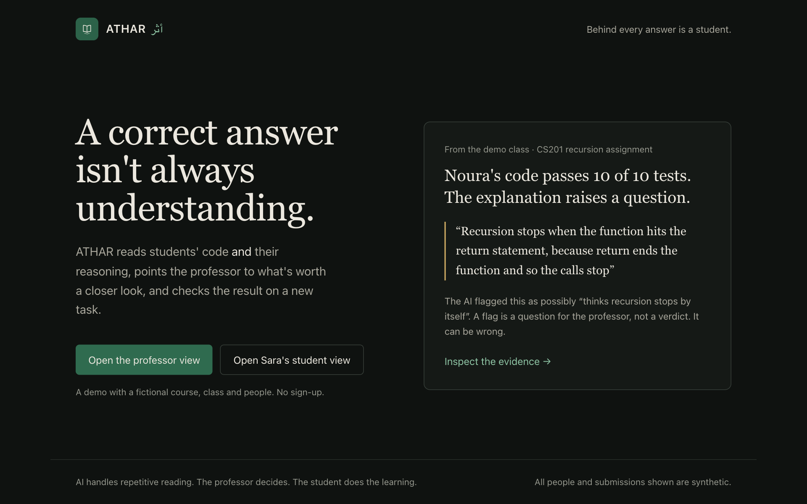
One real stored case, so a first-time visitor sees the idea in a few seconds. *Inspect the evidence* signs in as the professor and opens that submission.

## Professor

**Course overview: what needs attention today**
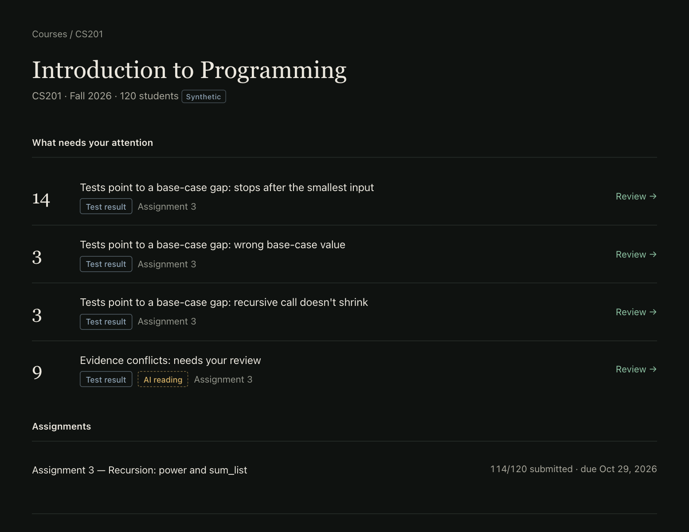

**Who needs attention: the review queue**
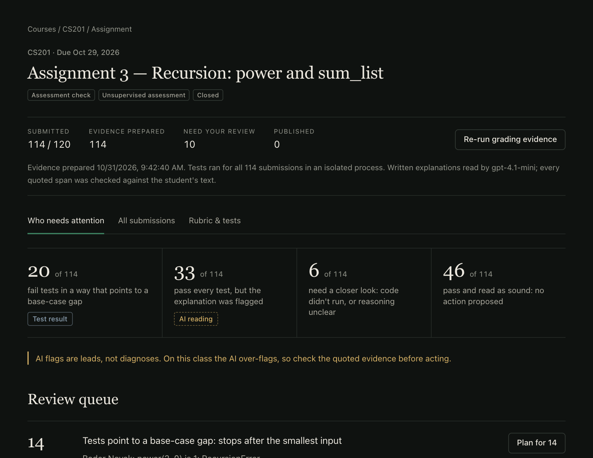
Each student is in exactly one group, built by fixed rules from test results and the stored AI reading. Amber marks evidence that rests partly on AI.

**Evidence review: working code, flagged reasoning (Noura)**
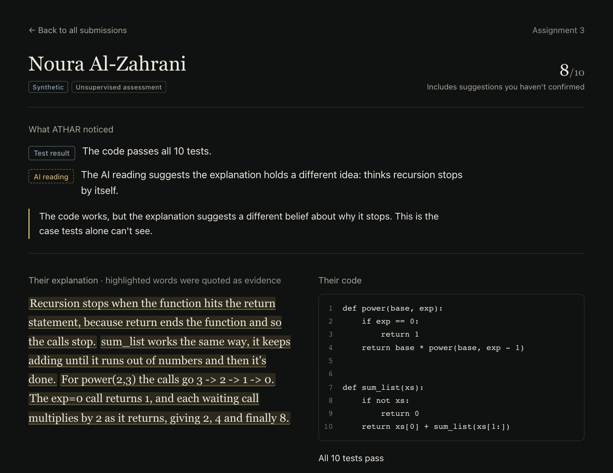

**Evidence review: conflicting evidence (Layan)**
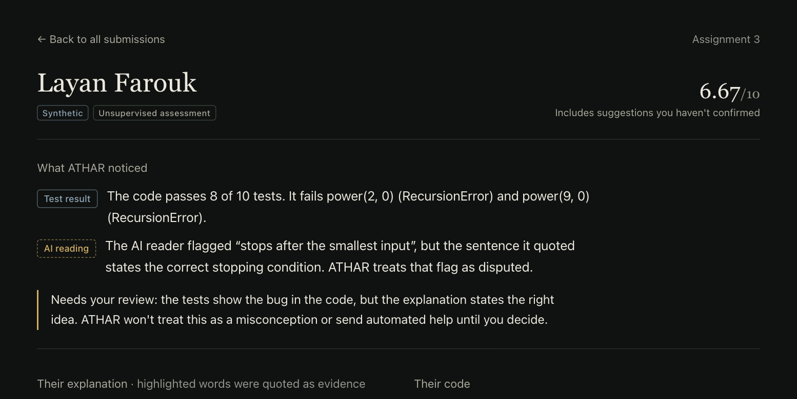
The AI's claim quotes a sentence that states the correct stopping condition, so ATHAR marks it as disputed and sends Layan to the professor. The original AI output stays below for audit.

**Proposed support and approval**
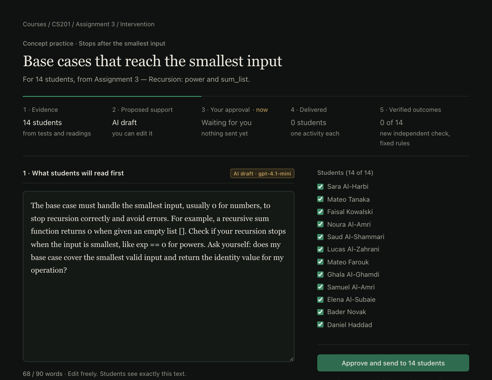
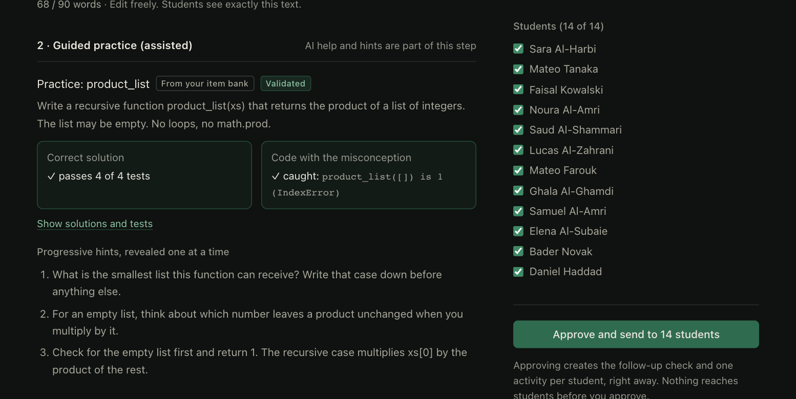

**Outcomes**
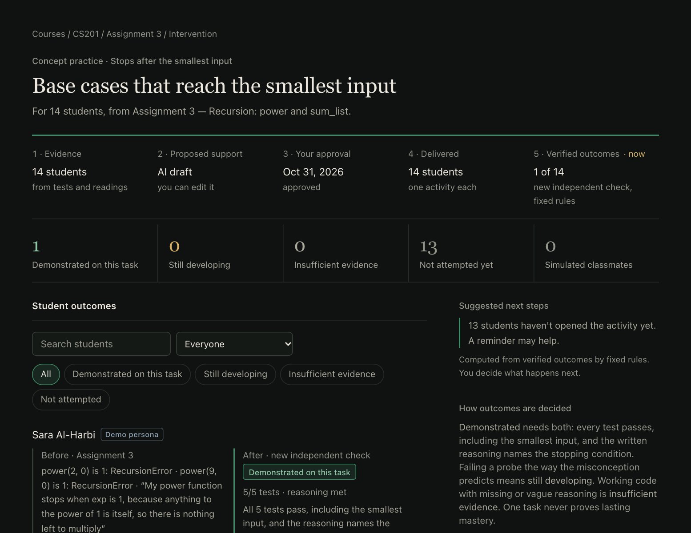

**Evaluation**
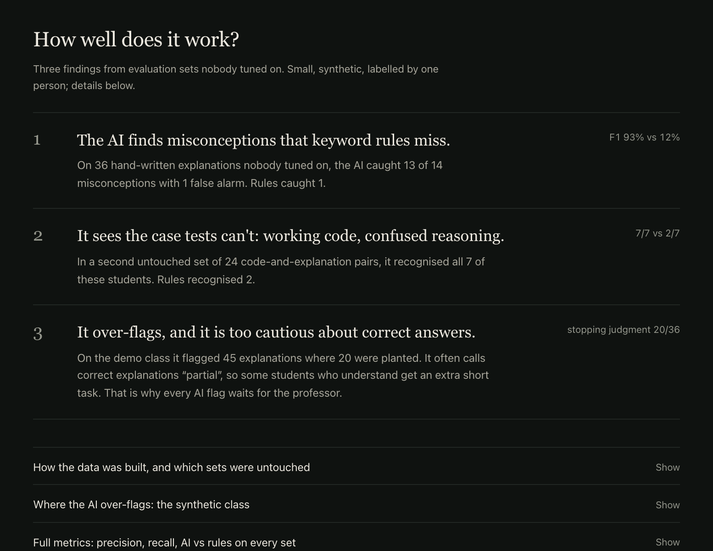

## Student (Sara)

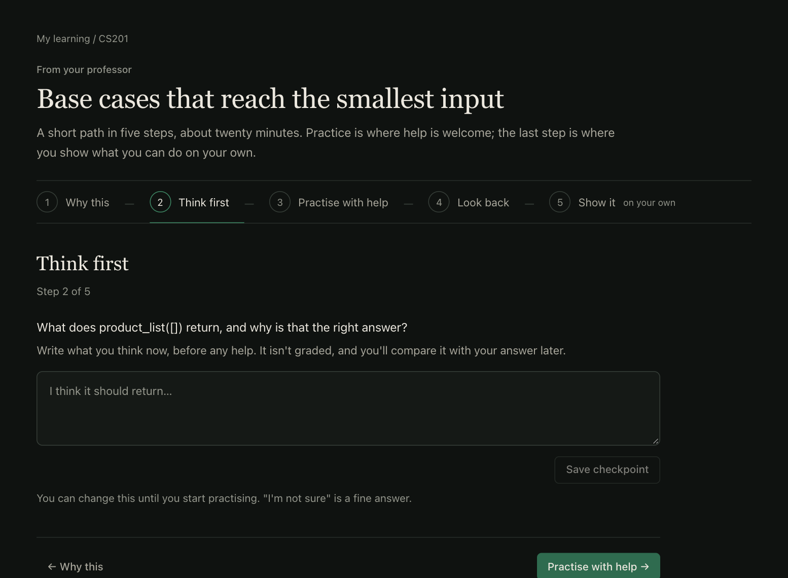
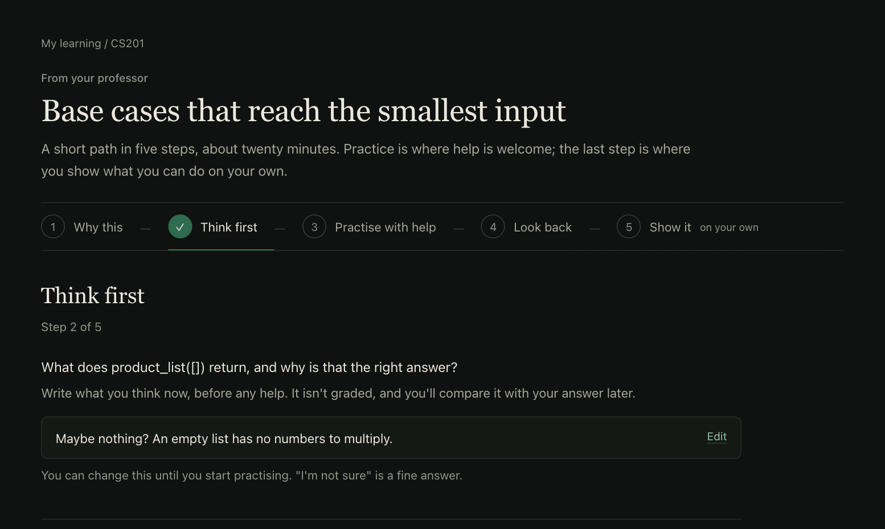
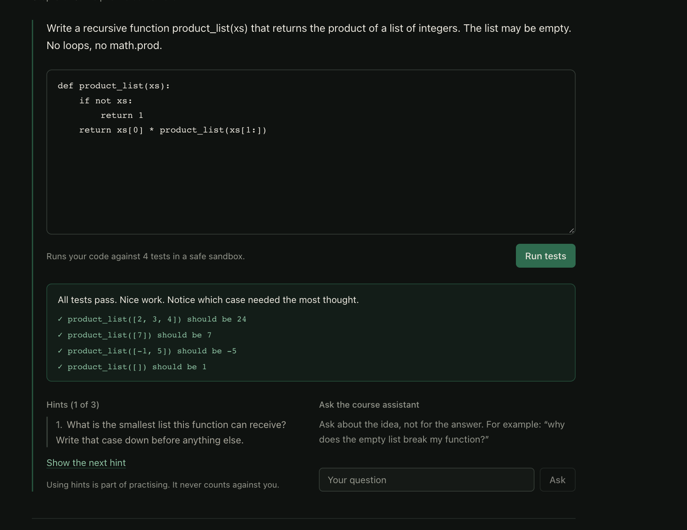
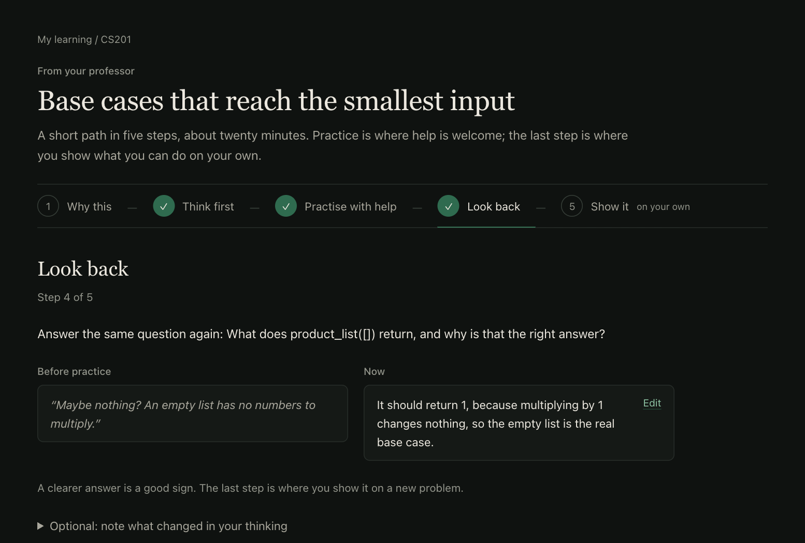
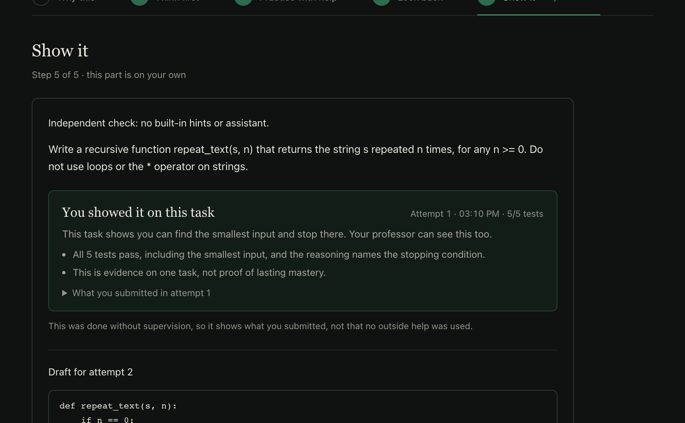
